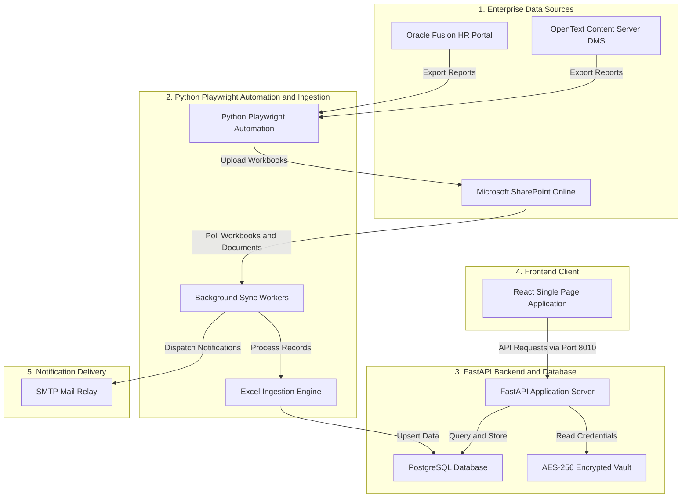

# NDC Tracking Platform
## Enterprise Operations Manual and Deployment Guide

### 1. System Overview

The NDC Tracking Platform is an enterprise clearance management and compliance audit system designed for Human Resources and Corporate Operations. It standardizes, tracks, and audits the complete employee separation lifecycle across 13 cross-functional approval departments.

The platform provides:
* Automated Ingestion: Downloads weekly resignation and clearance workbooks from Oracle Fusion and Microsoft SharePoint using Python Playwright automation.
* Clearance State Audit: Real-time status tracking across 13 sequential and concurrent approval stages (RM, IT, Abex, Telecom, Store, Safety, Administration, Security, HR, GCC HR, Business Specific, Final Abex, Legatrix).
* SLA and Turnaround Time (TAT) Analytics: Centralized tracking of clearance durations, approval velocity, and departmental bottlenecks.
* Full and Final (F&F) Document Verification: Automated scanning of SharePoint employee directories to verify Relieving Letters, Service Certificates, and F&F Statements.
* Outbound Communication Engine: Automated dispatch of daily clearance digests, approaching last-working-day alerts, SLA breach escalations, and finalized settlement letters with PDF documentation to separated employees.

---

### 2. System Architecture and Flow

The platform operates across four decoupled architectural layers: data sources, ingestion and automation, backend persistence and APIs, and client presentation.



#### Architectural Flow Description

1. Data Extraction: Scheduled Python Playwright scripts authenticate into Oracle Fusion and OpenText DMS, generate clearance and F&F reports, and transfer them into Microsoft SharePoint Online.
2. Ingestion and Normalization: Background workers poll SharePoint for new workbooks, parse binary (`.xlsb`) and standard (`.xlsx`) files, map raw stage texts into normalized states (`PENDING`, `IN_PROGRESS`, `COMPLETED`, `DEPENDENT`, `NOT_APPLICABLE`), and upsert records into PostgreSQL.
3. Document Verification: The background worker scans employee SharePoint folders to confirm the presence of Relieving Letters, Service Certificates, and F&F Statements.
4. API and Presentation: The FastAPI backend exposes REST endpoints consumed by the React Single Page Application through an inline development proxy or integrated production static file server.
5. Notification Dispatch: Scheduled background tasks query pending SLAs and completed F&F cases, generating automated HTML emails delivered through the corporate SMTP relay.

---

### 3. Repository Architecture

```
NDC-Tracking-Platform/
├── client/          Frontend web application (React 18, Vite 6, Tailwind CSS v4)
├── server/          Backend REST API, database engine, and Playwright automation (FastAPI, SQLAlchemy)
├── nginx/           Production reverse proxy configuration for enterprise hosting
└── README.md        Root operations manual and deployment specification
```

---

### 4. Technical Prerequisites

Ensure the following runtimes and services are installed before setup:

* Node.js: Version 18.x or 20.x LTS
* npm: Version 9.x or higher (or pnpm 8.x+)
* Python: Version 3.12 or higher
* uv: Package and environment manager (`pip install uv` or platform installer)
* PostgreSQL: Version 14 or higher (local or managed instance)
* Chromium: Installed via Playwright

---

### 5. Quick Start Application Setup

#### Step 5.1: Database Provisioning

Create a database instance in your PostgreSQL server:

```sql
CREATE DATABASE ndc_tracking_db;
```

---

#### Step 5.2: Start the Backend Service (`server/`)

1. Open a terminal and navigate to the `server/` directory:
   ```bash
   cd server
   ```

2. If `uv` is not yet installed on your machine, install it:
   * Windows (PowerShell):
     ```powershell
     powershell -ExecutionPolicy ByPass -c "irm https://astral.sh/uv/install.ps1 | iex"
     ```
   * Linux / macOS:
     ```bash
     curl -LsSf https://astral.sh/uv/install.sh | sh
     ```
   * Pip Alternative:
     ```bash
     pip install uv
     ```

3. Create and activate the Python virtual environment:
   ```bash
   uv venv --python 3.12
   ```
   * Windows PowerShell: `.\.venv\Scripts\Activate.ps1`
   * Windows Command Prompt: `.\.venv\Scripts\activate.bat`
   * Linux / macOS: `source .venv/bin/activate`

4. Install backend dependencies:
   ```bash
   uv sync
   ```

5. Install the Playwright Chromium browser binary:
   ```bash
   uv run playwright install chromium
   ```

6. Provision the mandatory backend environment file:
   * Windows: `Copy-Item .env.sample .env`
   * Linux/macOS: `cp .env.sample .env`

   Open `server/.env` and update your PostgreSQL connection parameters (`DB_USER`, `DB_PASSWORD`, `DB_HOST`, `DB_PORT`, `DB_NAME`). Detailed descriptions of all parameters are documented in [server/README.md](server/README.md).

7. Synchronize the database schema:
   ```bash
   uv run .\scripts\sync_db.py
   ```

8. Launch the backend application:
   ```bash
   uv run .\main.py
   ```
   The backend service starts at `http://127.0.0.1:8010`. Health check: `http://127.0.0.1:8010/health`.

---

#### Step 5.3: Start the Frontend Application (`client/`)

1. Open a second terminal and navigate to the `client/` directory:
   ```bash
   cd client
   ```

2. Install Node dependencies:
   ```bash
   npm install
   ```

3. Provision the mandatory frontend environment file:
   * Windows: `Copy-Item .env.sample .env`
   * Linux/macOS: `cp .env.sample .env`

   Configuration parameters (routing base path and feature flags) are documented in [client/README.md](client/README.md).

4. Launch the frontend development server:
   ```bash
   npm run dev
   ```
   The application initializes on `http://localhost:7002/ndc/ndc-reporting/overview`.

---

#### Step 5.4: Authentication and Initial Sign-In

The backend automatically provisions an initial Super Administrator account on first startup using the email configured in `server/.env`:

* Portal URL: `http://localhost:7002/ndc/login`
* Username: Value of `SUPER_ADMIN_EMAIL` in `server/.env` (default: `admin@example.com`)
* Initial Default Password: `Adani@123`

---

### 6. Operational Execution Models

#### Development Execution Model

During development, both processes execute concurrently:
* Frontend runs on Vite dev server at port 7002.
* Built-in proxy in `client/vite.config.ts` intercepts `/ndc/api/*` calls and forwards them to `http://127.0.0.1:8010/api/*`, eliminating CORS configuration needs.
* Backend runs via Uvicorn on port 8010 with active code reloading.

#### Production Model A: Integrated SPA Hosting

FastAPI can directly serve the compiled frontend bundle without running a separate Node.js server:
1. Build the frontend: `cd client && npm run build` (outputs to `client/dist/`).
2. Start the backend: `cd server && uv run .\main.py`.
3. The integrated router in `server/spa_server/router.py` automatically serves `client/dist/index.html` for all browser page requests on port 8010.

#### Production Model B: Nginx Reverse Proxy Deployment

For hosting on enterprise Linux servers behind an Nginx gateway:
1. Deploy `nginx/ndc-production.conf` into your Nginx configuration directory (`/etc/nginx/conf.d/`).
2. Set `VITE_BASE_PATH=/ndc/v2/` in `client/.env` and compile the frontend (`npm run build`).
3. Reload Nginx (`systemctl reload nginx`). All traffic targeting `https://<domain>/ndc/v2/` is reverse-proxied to the backend on port 8010.

---

### 7. Documentation Index

For exhaustive parameter guides, API schemas, and architectural breakdowns:

* Frontend Specification and Configuration: [client/README.md](client/README.md)
* Backend Architecture and Automation: [server/README.md](server/README.md)
* REST API Endpoint Catalog and JSON Schemas: [server/docs/api_documentation.md](server/docs/api_documentation.md)
* Production Nginx Reverse Proxy Configuration: [nginx/ndc-production.conf](nginx/ndc-production.conf)
